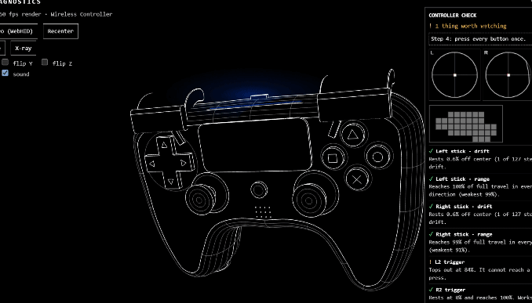

DS4 Skeleton 🎮

A little browser-based playground for the DualShock 4.

See your PS4 controller come to life in 3D. Press buttons, move the sticks, and experiment with real-time controller input, all in your browser.

<p align="center">  </p>

<p align="center"> <a href="https://mahith-dev.github.io/ds4-skeleton/"><strong>▶ Try the live demo</strong></a> </p>

## What can it do?

* View an interactive 3D model of the controller, with camera orbit and zoom.
* See button presses, D-pad input, analog sticks, and triggers update live.
* Use the browser Gamepad API to read supported controller input.
* Try the WebHID gyro connection for extra motion data on supported browsers and hardware.
* Explore the diagnostic controls for sticks, triggers, buttons, and touchpad input where available.
* Recenter or recalibrate the gyro, flip axes, and toggle X-ray, rumble, and sound options.

Not every feature works on every browser or controller setup. The regular Gamepad API inputs and the extra WebHID features have different compatibility requirements.

## Give it a try

The easiest way is to open the **[live demo](https://mahith-dev.github.io/ds4-skeleton/)** in a desktop browser and connect your controller.

For the best chance of getting the gyro features working, use a recent version of **Chrome or Edge**. When prompted, allow access to the controller. Button and stick input may work in more browsers, depending on the device and operating system.

If the page opens but a feature doesn't respond, it may be a browser or hardware limitation rather than a problem with the page.

## Run it on your computer

There’s no npm install or build command needed. You can serve the files locally with Python:

```bash
git clone https://github.com/mahith-dev/ds4-skeleton.git
cd ds4-skeleton
python -m http.server 8000
```

Then open `http://localhost:8000` in your browser.

If your repository has a different name or URL, update the clone command to match it.

## Controls

* **Drag the scene** to rotate the camera.
* **Scroll** to zoom in or out.
* **Connect gyro (WebHID)** to request access to a supported controller.
* **Recenter** to reset the current orientation reference.
* **Recalibrate** to measure the gyro's resting bias again.
* **X-ray** to switch the model's surface view.
* **Flip X / Y / Z** to invert individual gyro axes.
* **Rumble / sound** to toggle supported feedback.

The exact behavior depends on which features your controller and browser expose.

## How the project is organised

```text
ds4-skeleton/
├── index.html
├── README.md
├── .gitignore
└── assets/
    ├── css/
    │   └── style.css
    └── js/
        └── app.js
```

* `index.html` contains the page structure.
* `assets/css/style.css` holds the styling.
* `assets/js/app.js` contains the visualizer logic.

The page loads Three.js from a CDN, so you’ll need an internet connection when opening it for the first time.

## A couple of things to know

* WebHID is only available in supported browsers and secure contexts. The GitHub Pages demo uses HTTPS, and `localhost` works for local development.
* Controller behavior can vary with the controller revision, USB or Bluetooth connection, operating system, and browser.
* This project is a small experiment and diagnostic visualizer, not a guarantee that every DualShock 4 feature can be accessed from the browser.

## Built with

* HTML, CSS, and JavaScript
* [Three.js](https://threejs.org/) for the 3D view
* Browser Gamepad API and WebHID where supported

## Feedback

If you try it and find something broken, or have an idea for an improvement, feel free to open an issue in the repository. Contributions and suggestions are welcome.

---

Made by [mahith-dev](https://github.com/mahith-dev).
